# Passage

A self-hosted authentication service for home labs. Passage provides a single front door for all your self-hosted applications — users log in once, and every app they access can trust that identity.

---

## Screenshots

<p align="center">
  <a href="screenshots/01-sign-in.png">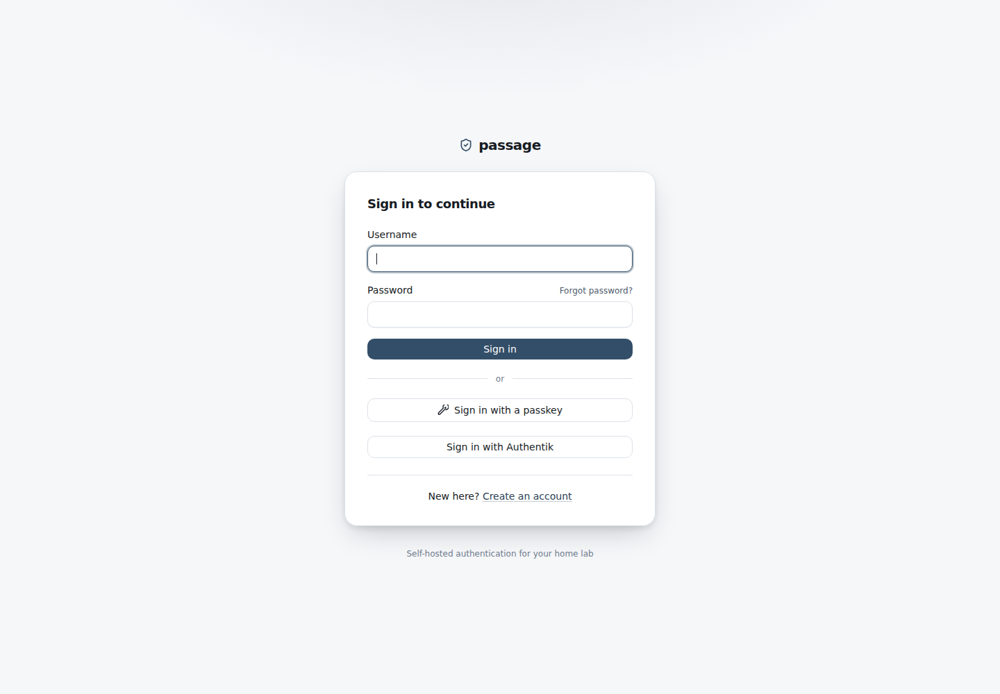</a>
  <a href="screenshots/02-my-apps.png">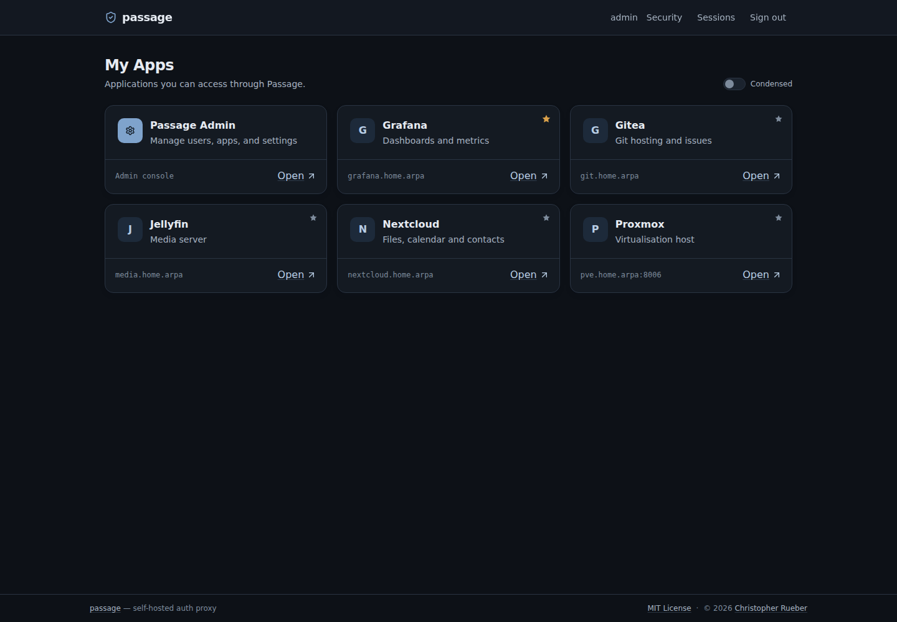</a>
  <a href="screenshots/03-security.png">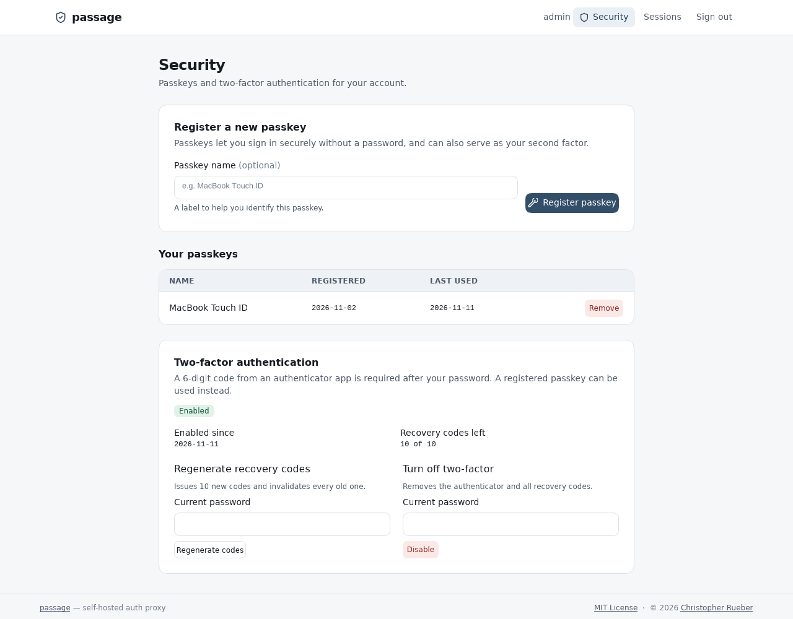</a>
</p>
<p align="center">
  <a href="screenshots/04-dashboard.png">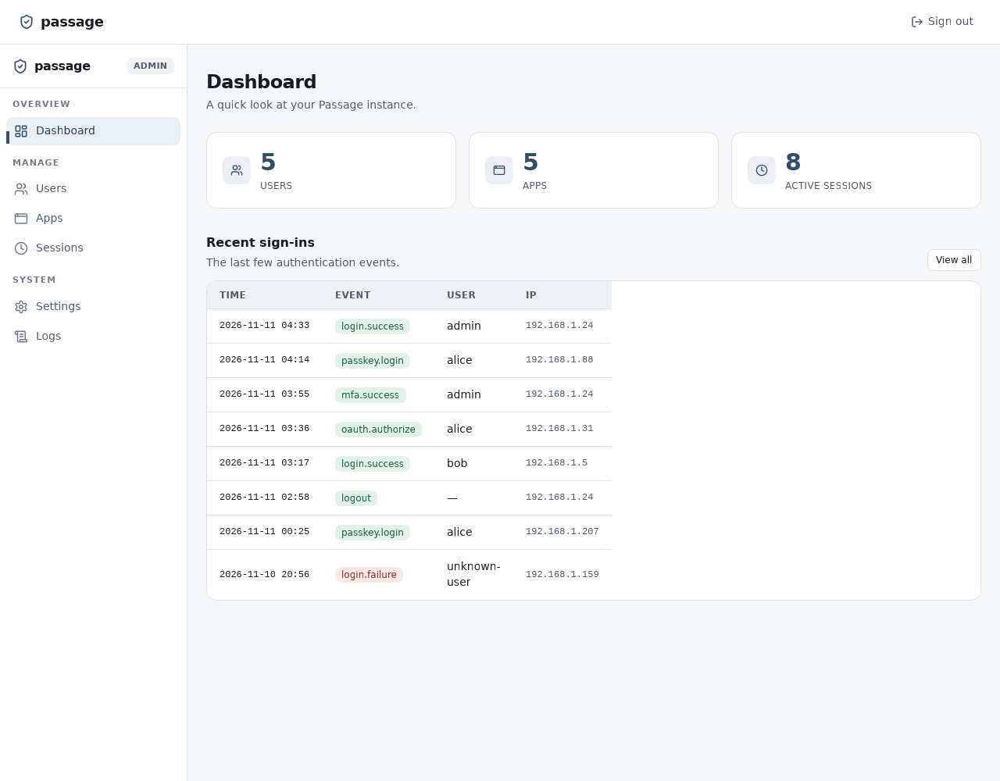</a>
  <a href="screenshots/05-apps.png">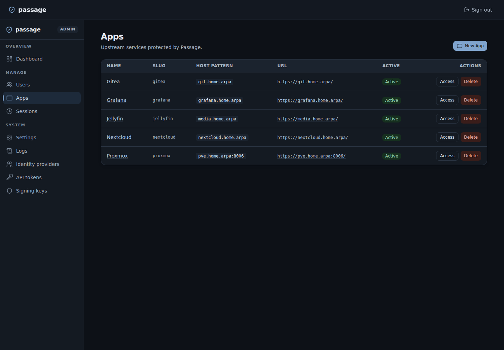</a>
  <a href="screenshots/06-logs.png">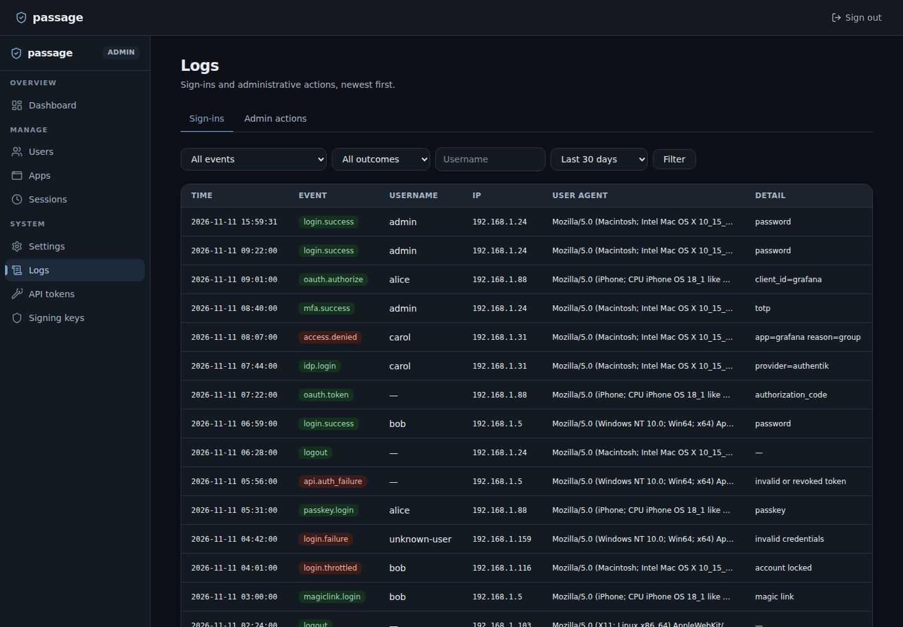</a>
</p>
<p align="center">
  <a href="screenshots/07-app-access-policy.png">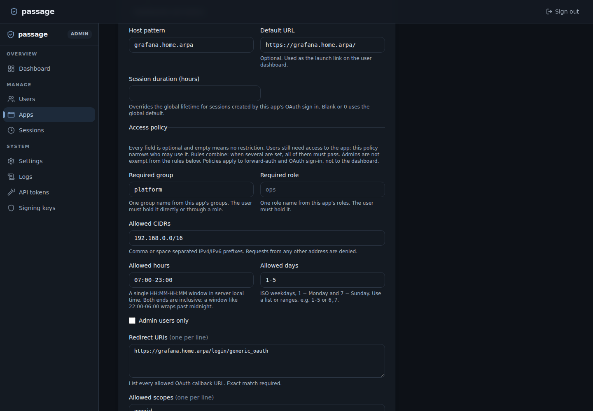</a>
  <a href="screenshots/08-signing-keys.png">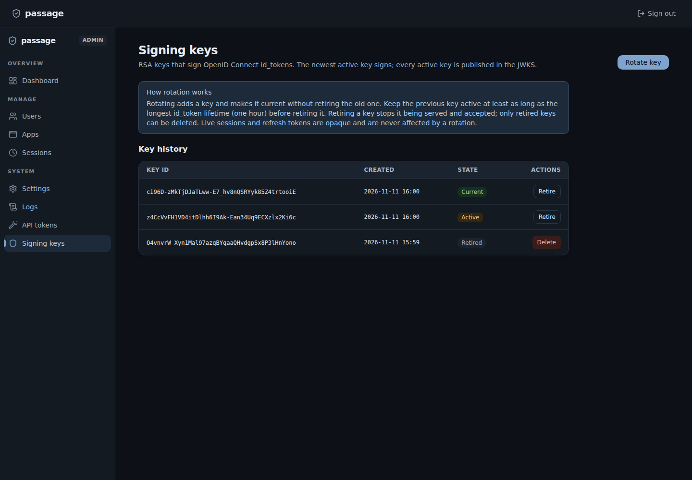</a>
  <a href="screenshots/09-api-tokens.png">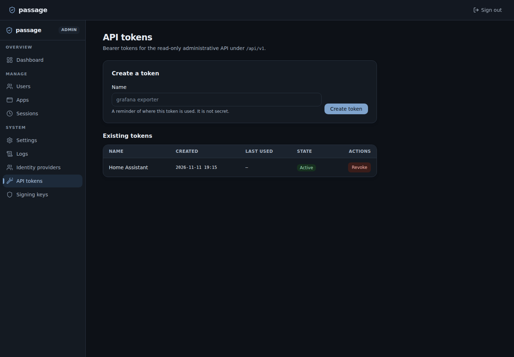</a>
</p>
<p align="center">
  <a href="screenshots/10-settings-general.png">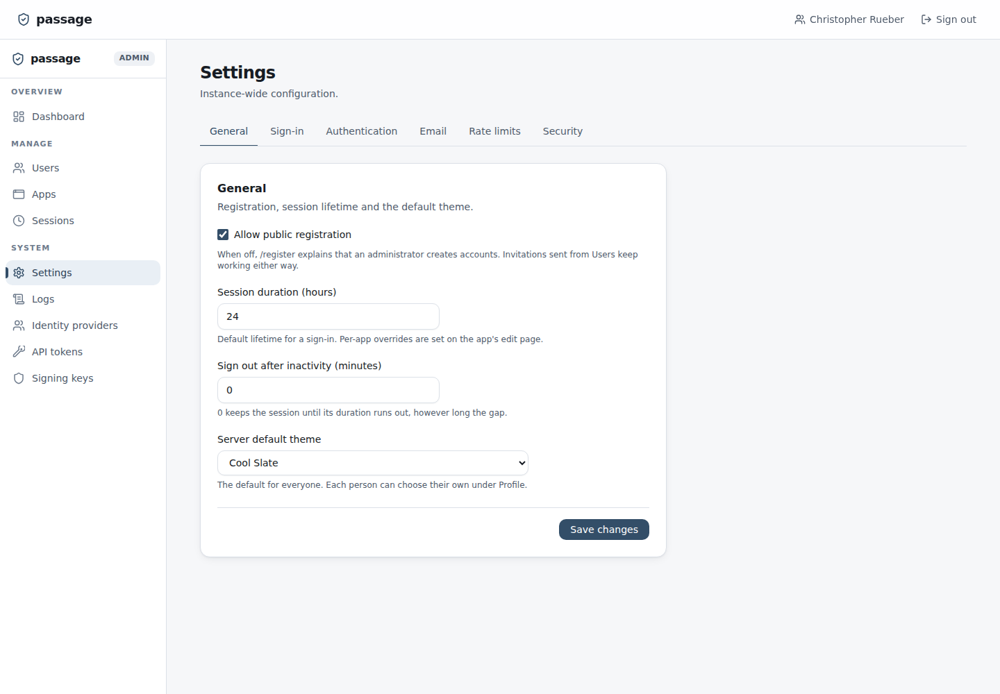</a>
  <a href="screenshots/11-settings-authentication.png">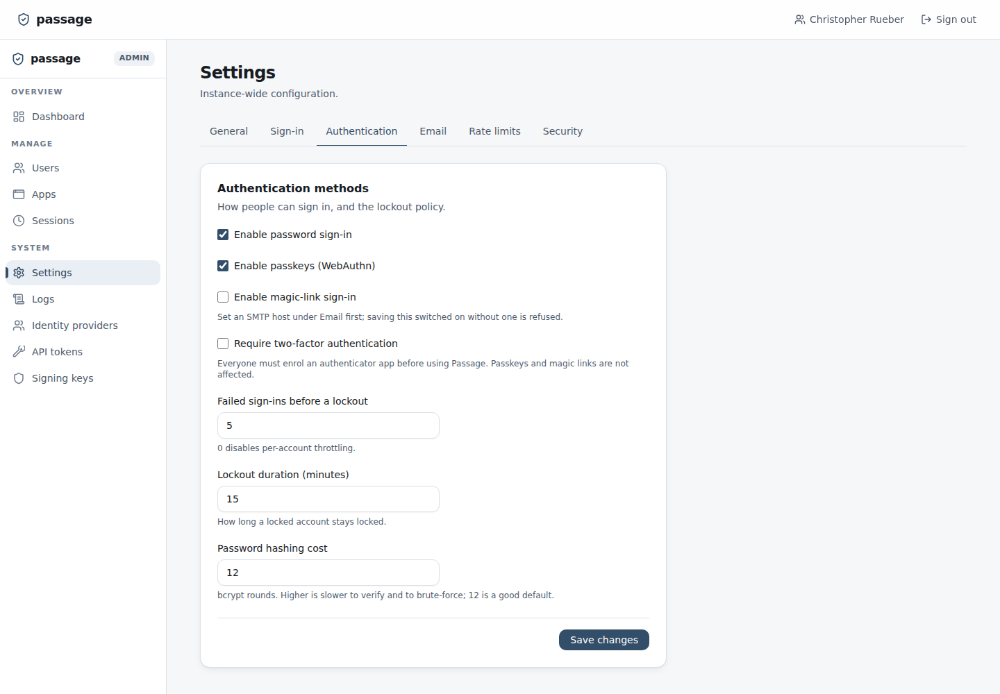</a>
  <a href="screenshots/12-identity-providers.png">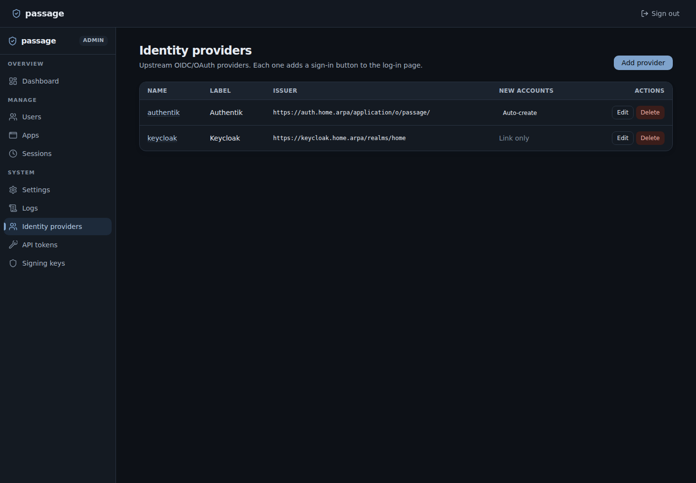</a>
</p>

<p align="center"><sub>Dark theme throughout; the sign-in page is shown in the light theme. Passage also ships nine other colour themes — see <a href="docs/theming.md">docs/theming.md</a>.</sub></p>

---

## How it works

Passage is an **OAuth 2.0 / OpenID Connect (OIDC) identity provider**. Applications delegate authentication to Passage using the standard authorization code flow. Users log in at Passage and are redirected back to the application with a verified identity — no per-app login screens, no duplicated credential stores.

```
Browser → App → Passage /oauth/authorize → login → redirect back with code
              ↓
         App exchanges code for tokens → id_token contains verified user identity
```

Any application that speaks OAuth 2.0 or OIDC works out of the box: Grafana, Gitea, Nextcloud, Jellyfin, and hundreds more.

Passage also supports the **forward-auth pattern** for reverse proxies (Nginx, Traefik) as an alternative for applications with no built-in auth support — see [docs/forward-auth.md](docs/forward-auth.md).

---

## Features

The single biggest, most important feature: **simplicity**. Passage is built for homelabs, not enterprise deployment. It is not meant to have dozens of auth scopes, brandable screens, or complex policy engines. It is the front door — one place to log in, one place to manage who has access to what.

- **OAuth 2.0 / OIDC Provider** — authorization code flow with PKCE (S256), rotating refresh tokens, discovery, JWKS, userinfo, RP-initiated logout, and token revocation/introspection
- **JWT access tokens** — signed with the same key as id_tokens, with per-app scope and audience (RFC 8707) registries and a revocation list, so downstream APIs can verify them offline
- **Username + password login** — bcrypt-hashed credentials stored in SQLite (cost configurable, default 12)
- **Passkeys (WebAuthn)** — register a platform authenticator or hardware key and sign in without a password; a passkey can also complete a password sign-in as its second factor
- **Two-factor authentication** — TOTP authenticator apps (enrol by QR code) plus single-use recovery codes; enforced on password sign-in, and optionally mandatory for every account
- **Per-account lockout** — after N invalid passwords the account is locked for a configurable window; an admin can unlock it, and the same counter bounds second-factor guessing
- **Per-app access control** — grant or revoke each user's access to each application independently, with app-scoped roles and groups
- **Favourites and a condensed view** — pin the apps you use most to the top of your dashboard, and switch the list to a tighter layout
- **Self-service sessions** — users see their devices, can revoke one or sign out everywhere; optional idle timeout
- **Self-service account settings** — change your display name, password, passkeys and two-factor without an administrator; a password change signs out every other session
- **Upstream identity providers** — add OIDC providers (Authentik, Keycloak, Google, …) in the admin UI; their sign-in buttons appear immediately, with optional account auto-creation and verified-email linking
- **Step-up authentication** — `prompt=login`, `max_age` and `acr_values` force a fresh sign-in for sensitive apps
- **Signing-key rotation** — rotate the OIDC key from the admin UI; kid history keeps existing id_tokens verifiable
- **Per-app access policies** — require an app group or role, restrict by CIDR or time of day, or make an app admin-only
- **Authentication log** — every sign-in, failure, lockout, passkey and magic-link use, MFA and OAuth event, filterable in the admin UI with 90-day retention
- **Read-only admin API** — `/api/v1` exposes users, apps, sessions and the audit log to scripts, authenticated with revocable API tokens
- **Prometheus metrics** — `/metrics` with authentication, session and HTTP counters plus instance gauges (optional bearer token)
- **Security webhook** — POST every authentication event as JSON, optionally HMAC-signed
- **Admin web UI** — manage users, apps (OAuth clients, access policies, groups and roles), sessions, settings, logs, API tokens and signing keys without touching config files
- **Email** — optional self-registration with address verification, administrator invitations, password reset, and magic-link sign-in
- **Secrets encrypted at rest** — TOTP secrets are sealed with AES-256-GCM; the key comes from config or a `0600` file beside the database
- **Thirteen colour themes** — slate, nord, gruvbox, solarized, catppuccin, tokyo-night, rose-pine, everforest, kanagawa, paper, github-light, one-light and ayu-light; set a server default and let each person choose their own under Profile (Paper, GitHub Light, One Light and Ayu Light stay light in dark mode)
- **Single static binary** — no runtime dependencies, no CGo, no Docker required to run
- **SQLite backing store** — a single `.db` file; no separate database server

The security model, storage guarantees, and operational notes live in [docs/security.md](docs/security.md).

### Documentation

| Guide | What it covers |
|---|---|
| [docs/security.md](docs/security.md) | Trust model, known limitations, webhook payloads, MFA and step-up |
| [docs/forward-auth.md](docs/forward-auth.md) | Nginx and Traefik integration |
| [docs/app-access-policies.md](docs/app-access-policies.md) | Per-app group, role, CIDR, admin-only, hours and days rules |
| [docs/idp.md](docs/idp.md) | Signing in with an upstream OIDC provider and account linking |
| [docs/jwt-access-tokens.md](docs/jwt-access-tokens.md) | Access-token format, scopes and RFC 8707 resource indicators |
| [docs/oauth-signing-key-rotation.md](docs/oauth-signing-key-rotation.md) | Rotating the OIDC signing key without breaking live tokens |
| [docs/admin-api.md](docs/admin-api.md) | The read-only `/api/v1` endpoints and API tokens |
| [docs/metrics.md](docs/metrics.md) | Prometheus metrics and what each one counts |
| [docs/theming.md](docs/theming.md) | Colour themes, the token contract, and adding a theme |

---

## Quick start

### Docker Compose (recommended)

The repository ships a ready-to-use `docker-compose.yml`. Copy the example env file, set your public URL, and start:

```bash
cp .env.example .env
# Edit .env — at minimum set PASSAGE_SERVER_BASE_URL
docker compose up -d
```

A minimal `docker-compose.yml` looks like this:

```yaml
services:
  passage:
    image: ghcr.io/crueber/passage:latest
    restart: unless-stopped
    ports:
      - "8080:8080"
    environment:
      PASSAGE_SERVER_BASE_URL: "https://auth.home.example.com"
      PASSAGE_DATABASE_PATH: "/data/passage.db"
      PASSAGE_SESSION_COOKIE_SECURE: "true"
      # SMTP, sign-in options, rate limits and the rest are configured in the
      # admin UI after first start.
    volumes:
      - passage_data:/data
    healthcheck:
      test: ["CMD", "wget", "-qO-", "http://localhost:8080/healthz"]
      interval: 30s
      timeout: 5s
      start_period: 15s
      retries: 3

volumes:
  passage_data:
```

The full `docker-compose.yml` (with all environment variables and their defaults) is included in the repository.

On first start with an empty database, a one-time setup token is printed to stdout:

```
docker compose logs passage | grep setup
```

Visit `https://auth.home.example.com/setup` and use the token to create the first admin account. That endpoint disables itself as soon as an admin exists.

### Binary (no Docker)

```bash
# Build
CGO_ENABLED=0 go build -o passage ./cmd/passage

# Copy and edit the example config
cp passage.example.yaml passage.yaml
# edit passage.yaml — at minimum set server.base_url

# Run
./passage --config passage.yaml
```

The server starts on `0.0.0.0:8080` by default. Visit `http://localhost:8080/healthz` to confirm it is running.

---

## Configuration

Passage is configured in two places:

- **`passage.yaml`** — bootstrap only: where the server listens, the public base URL, the database path, session-cookie shape, key material and logging. Every key can also be set through a `PASSAGE_*` environment variable, which wins over the file.
- **The admin UI (Settings)** — everything that describes how the instance behaves: sign-in methods, registration, session lifetime and idle timeout, sign-in branding, theme, SMTP/email, account lockout, rate limits, the security webhook, Prometheus metrics and upstream identity providers. These values live in the database and are applied immediately, except the few marked "takes effect after a restart" (rate limits, lockout thresholds, the webhook, SMTP, the metrics endpoint and the password-hashing cost), which are read once at startup.

```yaml
# passage.yaml — copy from passage.example.yaml and edit
server:
  host: "0.0.0.0"
  port: 8080
  base_url: "https://auth.home.example.com"   # required — email links, WebAuthn, OIDC discovery

database:
  path: "./passage.db"

session:
  cookie_name: "passage_session"
  cookie_secure: true    # false only for local HTTP development

security:
  encryption_key: ""     # AES-256-GCM key for TOTP secrets; empty = a 0600 key file beside the database

csrf:
  key: ""                # optional CSRF signing secret (64+ hex characters)

log:
  level: "info"          # "debug" | "info" | "warn" | "error"
  format: "json"         # "json" | "text"

auth:
```

### Environment variable overrides

| Variable | Overrides |
|---|---|
| `PASSAGE_SERVER_HOST` | `server.host` |
| `PASSAGE_SERVER_PORT` | `server.port` |
| `PASSAGE_SERVER_BASE_URL` | `server.base_url` |
| `PASSAGE_DATABASE_PATH` | `database.path` |
| `PASSAGE_SESSION_COOKIE_NAME` | `session.cookie_name` |
| `PASSAGE_SESSION_COOKIE_SECURE` | `session.cookie_secure` |
| `PASSAGE_SECURITY_ENCRYPTION_KEY` | `security.encryption_key` |
| `PASSAGE_CSRF_KEY` | `csrf.key` |
| `PASSAGE_LOG_LEVEL` | `log.level` |
| `PASSAGE_LOG_FORMAT` | `log.format` |

Feature settings have no environment variables: set them in the admin UI.

---

## OAuth 2.0 / OIDC Provider

Passage acts as an OpenID Connect identity provider for downstream applications (Grafana, Gitea, Nextcloud, etc.) using the standard authorization code flow.

> **Requirement**: `server.base_url` (or `PASSAGE_SERVER_BASE_URL`) must be set to Passage's public URL for OIDC discovery to work correctly.

### Endpoints

| Endpoint | Method | Description |
|---|---|---|
| `/.well-known/openid-configuration` | `GET` | OIDC discovery document |
| `/.well-known/jwks.json` | `GET` | JSON Web Key Set (RSA public key for id_token verification) |
| `/oauth/authorize` | `GET` | Authorization endpoint — redirects to login if no session |
| `/oauth/token` | `POST` | Token endpoint — `authorization_code` and `refresh_token` grants |
| `/oauth/userinfo` | `GET` | UserInfo endpoint — requires `Bearer` access token |
| `/oauth/logout` | `GET`/`POST` | RP-initiated logout — verifies `id_token_hint`, revokes the SSO session |
| `/oauth/revoke` | `POST` | RFC 7009 token revocation (access or refresh token) |
| `/oauth/introspect` | `POST` | RFC 7662 token introspection |

The RSA signing key is generated on first start and stored in the database, with key rotation and kid history available from the admin UI (System → Signing keys). Old keys stay valid for verification until you retire them, so rotating does not invalidate live tokens.

Access tokens are RS256 JWTs signed by the same keyring, so a downstream API can verify them offline against the JWKS. Each app can carry an **allowed-scope** list and an **allowed-audience** list (RFC 8707 resource indicators); both are optional, and empty means the pre-existing behaviour — any requested scope is granted and no resource indicator is accepted. Revoking a JWT adds its `jti` to a denylist, so introspection, userinfo and validation reject it immediately. See [docs/jwt-access-tokens.md](docs/jwt-access-tokens.md).

### Setting up a client

1. In the Passage admin UI, open an application and enable OAuth. Generate OAuth credentials to receive a `client_id` and `client_secret`.
2. Add the downstream app's callback URL(s) as allowed redirect URIs.
3. Configure the downstream application with the `client_id`, `client_secret`, and Passage's `base_url` as the issuer.

### Grafana example (Generic OAuth)

```ini
[auth.generic_oauth]
enabled           = true
name              = Passage
client_id         = <your-client-id>
client_secret     = <your-client-secret>
scopes            = openid profile email
auth_url          = https://auth.home.example.com/oauth/authorize
token_url         = https://auth.home.example.com/oauth/token
api_url           = https://auth.home.example.com/oauth/userinfo
use_id_token      = true
# Map Passage is_admin claim to Grafana admin role (optional)
role_attribute_path = is_admin && 'Admin' || 'Viewer'
```

id_tokens are signed with RS256. Grafana (and any OIDC-compliant library) can verify them automatically via the JWKS endpoint.

---

## Forward-auth (reverse proxy)

For applications without native OAuth/OIDC support, Passage supports the forward-auth pattern with Nginx and Traefik. See [docs/forward-auth.md](docs/forward-auth.md) for setup instructions.

---

## Development

### Requirements

- Go 1.25 or later (see `go.mod`)
- `CGO_ENABLED=0` — no CGo, ever

### Build

```bash
# Standard build
CGO_ENABLED=0 go build -o passage ./cmd/passage

# With version injected
CGO_ENABLED=0 go build -ldflags "-X main.version=0.1.0" -o passage ./cmd/passage
```

### UI stylesheet (Tailwind)

The UI is styled with Tailwind CSS v4, compiled locally — no Node, no CDNs. The source of truth is `internal/web/ui/input.css`; the committed `internal/web/static/passage.css` is generated output.

```bash
# After editing input.css, rebuild the stylesheet (fetches the standalone
# tailwindcss binary into tools/ on first use — see tools/build-css.sh)
make css
```

CI fails if the committed `passage.css` doesn't match a fresh build, so always commit the rebuilt file together with your `input.css` change. Never hand-edit `passage.css`.

### Themes

Colour themes are plain CSS custom-property overrides, one file per theme in `internal/web/ui/themes/`. They are concatenated into `internal/web/static/themes.css` — no Tailwind involvement — and loaded after `passage.css` so the selected theme wins the cascade.

```bash
make themes    # rebuild static/themes.css from internal/web/ui/themes/*.css
make assets    # both: Tailwind stylesheet + themes
```

CI also runs `./tools/build-themes.sh --check` and fails if the committed `themes.css` is stale. See [docs/theming.md](docs/theming.md) for the token contract, contrast gate, and how to add a theme.

### Test

```bash
# All tests with race detector (required)
go test -race ./...

# Single package
go test -race ./internal/user/...
go test -race ./internal/session/...
go test -race ./internal/app/...
go test -race ./internal/forwardauth/...
go test -race ./internal/admin/...
go test -race ./internal/webauthn/...
go test -race ./internal/oauth/...
```

Tests use a real in-memory SQLite database — no mocks at the database layer. The `internal/testutil` package provides `NewTestDB(t)` for setting up a fully migrated test database.

### Vet and tidy

```bash
go vet ./...
go mod tidy
```

### Full pre-commit checklist

```bash
CGO_ENABLED=0 go build ./...
go vet ./...
go test -race ./...
go mod tidy && git diff --exit-code go.mod go.sum
```

---

## Security audit notes

- **Passwords**: bcrypt, minimum cost 10, default 12. Minimum password length: 8 characters.
- **Session tokens**: 32 bytes of `crypto/rand` entropy (64-char hex). Never `math/rand`.
- **Reset tokens**: 32 bytes of `crypto/rand`. Single-use (`used_at` stamped on redeem). 1-hour TTL.
- **Cookies**: `HttpOnly`, `Secure` (configurable for HTTP dev), `SameSite=Lax`.
- **CSRF**: All mutations use POST with a synchronizer token (`_csrf` hidden field, or `HX-CSRF-Token` header for htmx). On authenticated routes the token is HMAC-signed with the session token; on anonymous routes (login, register, reset) a double-submit cookie pattern is used. Setting `PASSAGE_CSRF_KEY` binds anonymous tokens to a server-side secret for defence against subdomain attacks. `SameSite=Lax` is an additional layer.
- **SQL**: All queries use parameterized statements — no string concatenation in SQL.
- **Templates**: `html/template` auto-escaping on all rendered output — no `template.HTML()` bypasses.
- **Admin routes**: `is_admin` checked against the database on every admin request; not cached.
- **API tokens**: `pst_` prefixed, 32 bytes of `crypto/rand`, stored as a SHA-256 digest and shown once. Every rejected credential gets the same `401`, and a rejection is written to the authentication log.
- **Metrics**: `/metrics` can require a bearer token (`metrics.token`); the token is compared in constant time and never logged.

---

## Acknowledgements

Passage is built on the shoulders of these excellent open-source projects:

- [go-chi/chi](https://github.com/go-chi/chi) — lightweight, idiomatic Go HTTP router
- [pressly/goose](https://github.com/pressly/goose) — database migration tool
- [wneessen/go-mail](https://github.com/wneessen/go-mail) — modern Go mail library
- [golang.org/x/crypto](https://pkg.go.dev/golang.org/x/crypto) — Go supplementary cryptography libraries
- [modernc.org/sqlite](https://gitlab.com/cznic/sqlite) — pure-Go SQLite driver (no CGo)
- [go-webauthn/webauthn](https://github.com/go-webauthn/webauthn) — WebAuthn/passkeys library for Go
- [gopkg.in/yaml.v3](https://github.com/go-yaml/yaml) — YAML support for Go
- [Tailwind CSS](https://tailwindcss.com) — utility-first CSS framework (v4, compiled locally with the standalone CLI)
- [htmx](https://htmx.org) — high power tools for HTML

---

## License

MIT — see [LICENSE](LICENSE)
