# 001 — My Apps redesign

**Status:** direction chosen — hybrid riff · **Scope:** design only — no application code changed

The current My Apps page is a three-column card grid. Each card carries an icon,
name, description, host and an “Open” action. It works, but with 19 apps it takes
seven rows and roughly 1,400 px of vertical space, every card has the same weight,
and a user with one app gets a single lonely card in an otherwise empty page.

This plan explores three directions. Nothing here is committed; the goal is to
pick a direction and riff on it.

## Goals

- Reduce vertical space for a typical 10–20 app account without hiding apps.
- Create hierarchy: favourites should feel different from the rest.
- Make scanning faster than reading 19 identical cards.
- Give a single-app account a deliberate state, not a stranded card.
- Keep the existing affordances: pin/unpin, host/launch URL, and a quick “Open”.
- Stay accessible and usable on mobile.

## Current data available

- `user_app_access` grants plus `favorite` (per-user pin).
- App name, description, slug, host pattern and default URL.
- No “last opened” or category data exists today. Ideas that use recents or
  categories will need a small schema addition (for example
  `user_app_access.last_opened_at`, or an app category/group field). That cost
  is called out per idea rather than assumed.

## Idea 1 — Grouped list

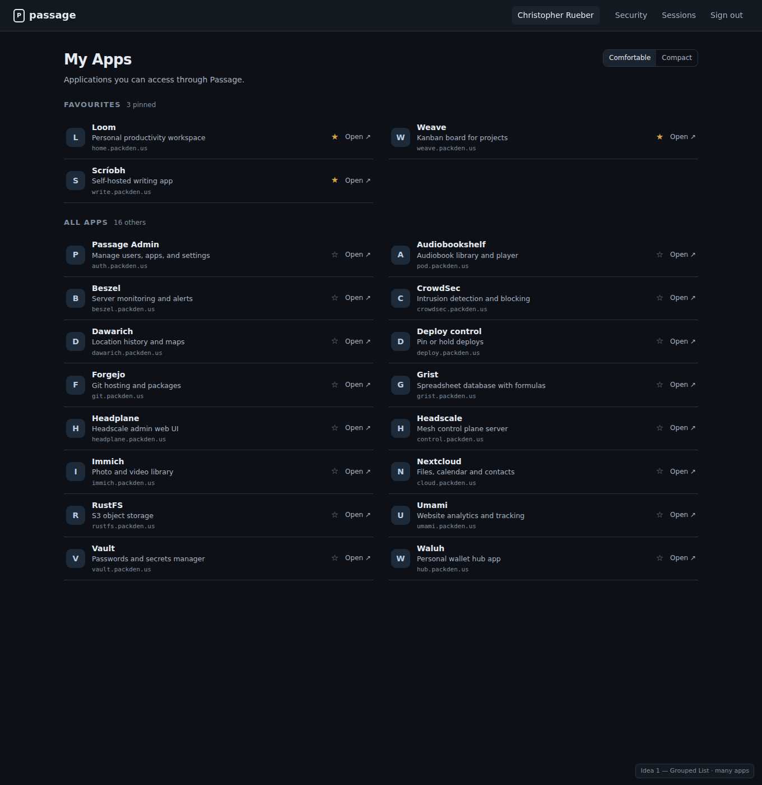

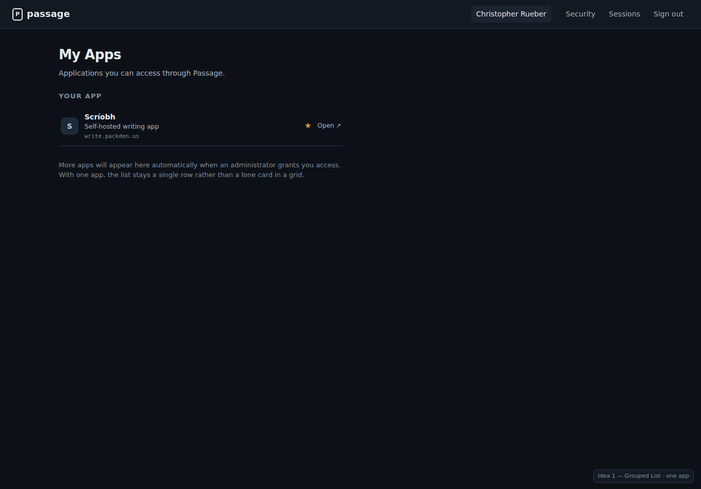

**Shape:** favourites are a small group at the top; everything else is a dense
two-column list of 60 px rows. The row is the click target; the star and “Open”
are explicit affordances. A Comfortable/Compact switch drops descriptions in
compact mode.

- Rows: icon, name, one-line description, host, star, Open.
- Groups: **Favourites** first, then **All apps** alphabetically.
- Comfortable shows descriptions; Compact shows name + host only.
- An app can appear in both groups (pin is a shortcut, not a removal).

**Single-app state:** one full-width row plus a short note that more apps appear
when access is granted. It reads as a list with one item rather than a card
floating in a grid. The page is still sparse; a future version could add a small
“Access is managed by your administrator” aside, but that risks adding chrome
where none is needed.

**Pros:** strongest hierarchy; very space-efficient; easy to scan names and
hosts; natural keyboard/tab order.
**Cons:** less visual/icon-led than cards; descriptions can still make rows
busy; pinning duplicates an app unless the pinned group replaces its row.

**Open questions:** one column or two? Should favourites be removed from “All
apps” while pinned? Is Compact the default for accounts above N apps?

## Idea 2 — Launcher

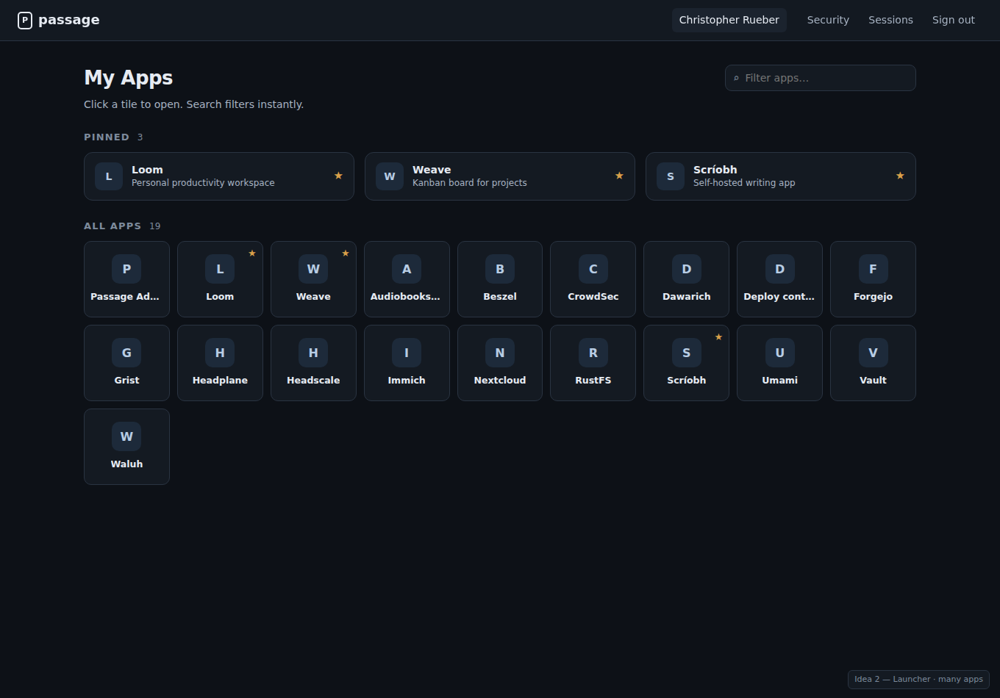

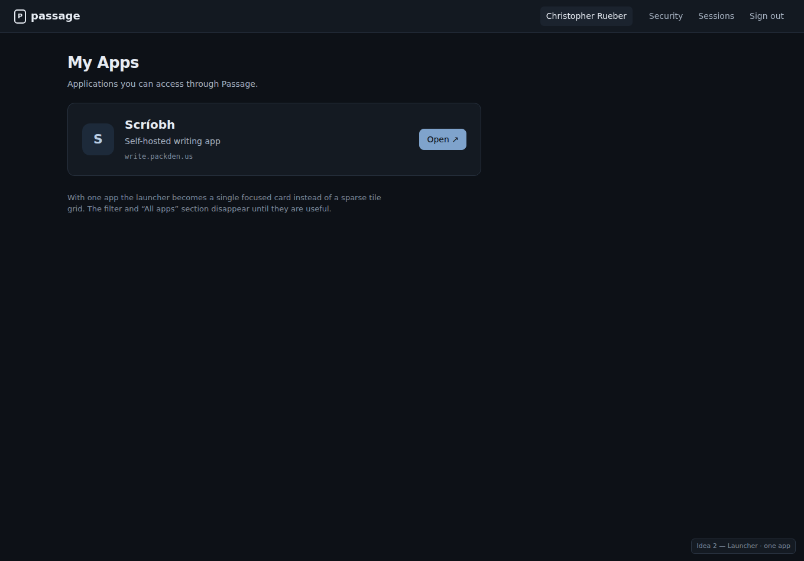

**Shape:** a pinned shelf of three larger cards, then a dense icon launcher.
Tiles are roughly 112 px wide, eight per row on desktop, with the name under the
icon. Descriptions and hosts live in a `title` tooltip; the star appears on hover
and stays visible for pinned apps. A filter field sits in the page header.

- Pinned: three compact cards with name/description and star.
- All apps: icon tiles, name under the icon, filter above.
- Icons become the primary recognition cue; text is secondary.
- Single app: the layout becomes one focused card with icon, description, host
  and an Open button. Filter and the All Apps section disappear.

**Pros:** by far the most space-efficient; feels like a launcher rather than a
directory; scanning is fast once icons are learned; the single-app card is
strong.
**Cons:** descriptions/hosts are hidden; icon-only recognition fails when
several apps share a letter; filter is less useful when the list is short;
pinned duplicates appear in All apps unless filtered out.

**Open questions:** how large should tiles be? Should every tile keep a visible
star, or only favourited ones? Should the pinned shelf collapse into the first
row of All apps instead of being a separate group?

## Idea 3 — Spotlight

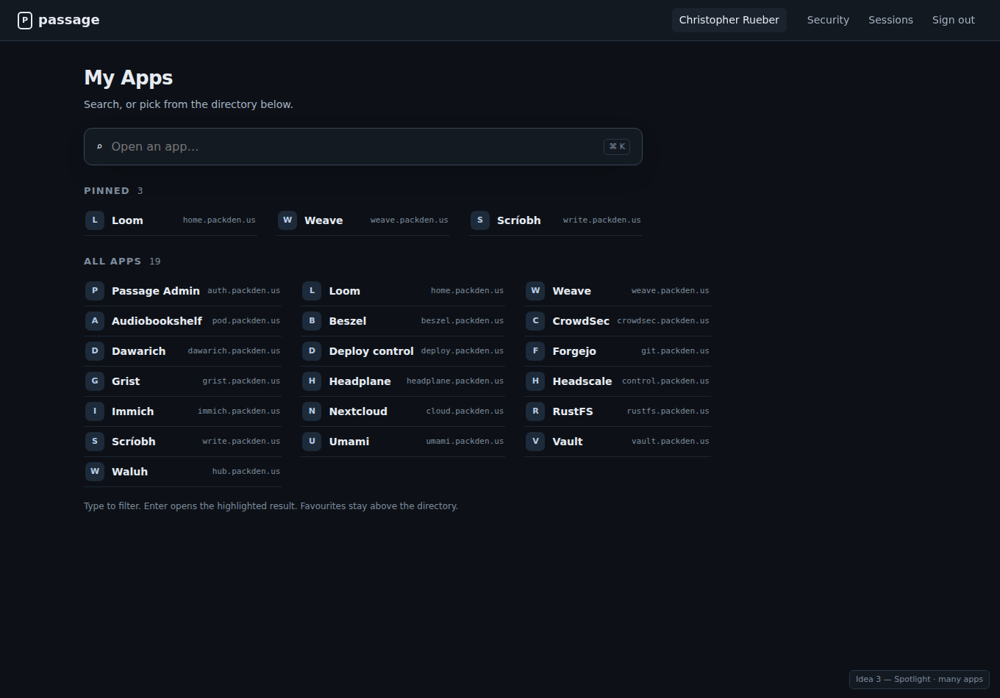

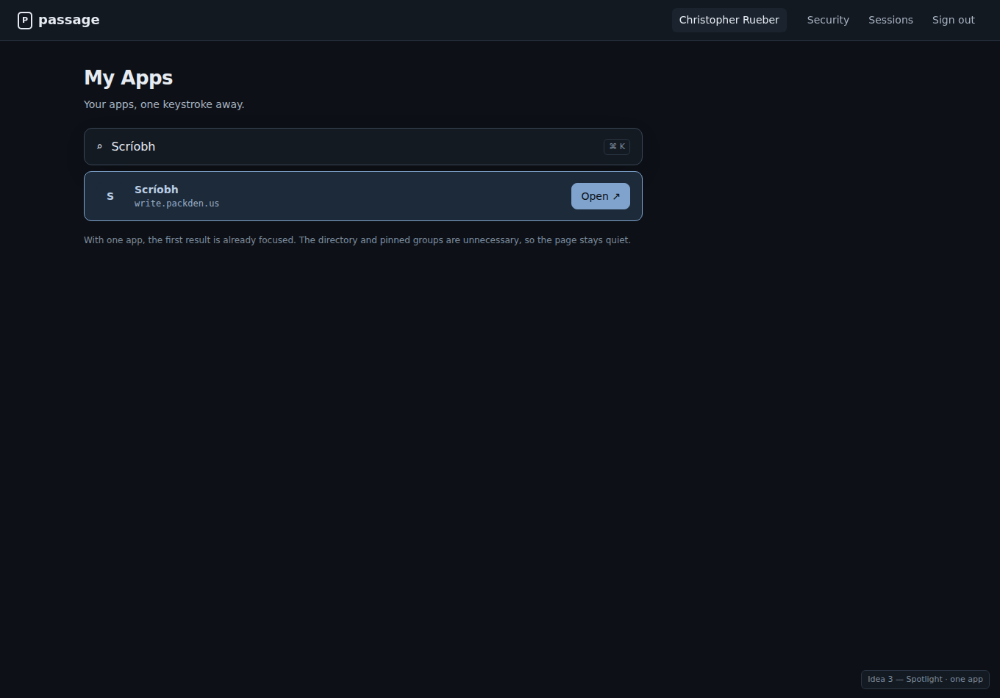

**Shape:** search is the primary control. A large “Open an app…” field with a
`⌘K` hint sits above a compact pinned row and an A–Z directory in three columns.
Typing filters immediately; Enter opens the highlighted result. With one app,
the search field is pre-filled and the single result is focused; the directory
and pinned groups disappear.

- Search-first header with keyboard shortcut.
- Pinned row of compact links.
- All apps as a dense alphabetical directory, three columns.
- Single app: one focused result, no directory.

**Pros:** fastest for people who know the app name; very dense; scales well
beyond 50 apps; keyboard-friendly.
**Cons:** hides the breadth of available apps until you search; less visual than
either card or tile layouts; requires client-side filtering (simple) and ideally
keyboard navigation; discovery of new apps is weaker.

**Open questions:** should the directory be visible by default, or only after
focusing search? Do we want recents above the directory (requires
`last_opened_at`)? Is `⌘K` appropriate on Windows/Linux (show `Ctrl K`)?

## Chosen direction — hybrid

The chosen direction combines Idea 1's structure with Idea 2's icon mode and
Idea 3's keyboard launcher.

### Comfortable / Iconized switch

The current Condensed switch becomes a two-state **Comfortable / Iconized**
switch. It changes the whole page, not just the card density.

**Comfortable** keeps the grouped list: Favourites then All apps, with icon,
name, description, host, star and Open per row.

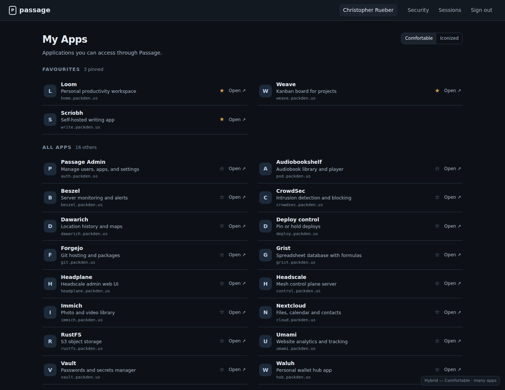

**Iconized** turns every app into a compact tile and compresses the favourites
into a single shelf. The tile star is always present — outlined when not
favourited, amber when it is — so pinning never requires opening the app first.
Descriptions and hosts move to the tile tooltip.

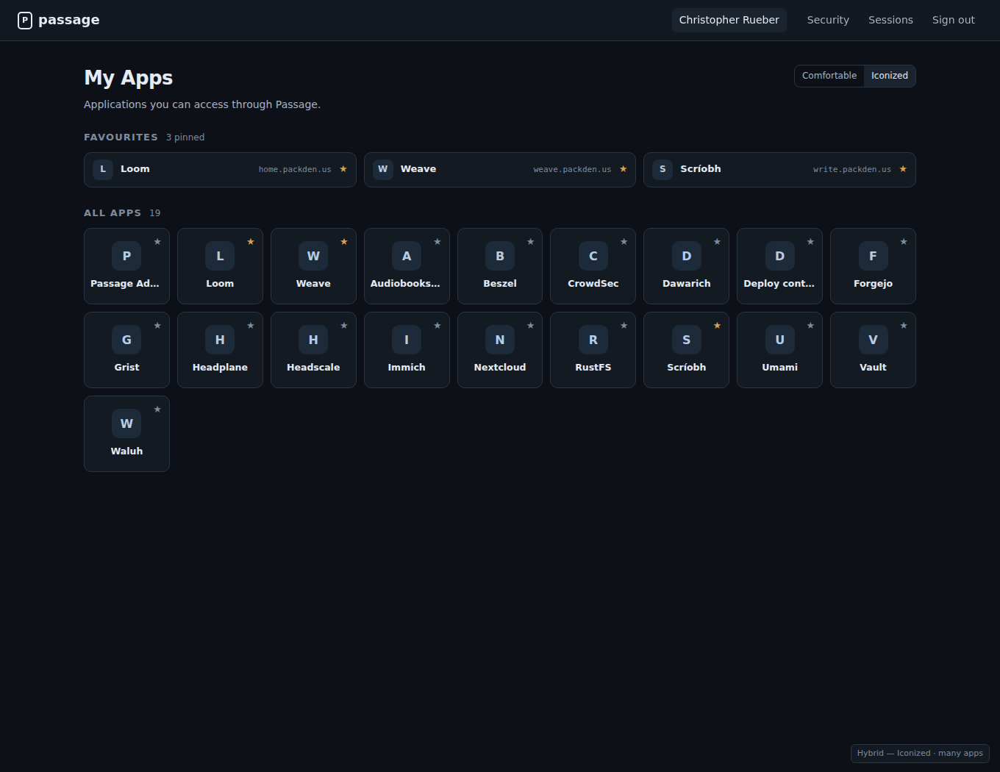

The single-app state follows the same mode:

- Comfortable: one full-width row plus the “more apps will appear” note.
- Iconized: one focused card with description, host and Open, instead of a
  lone tile in an empty grid.

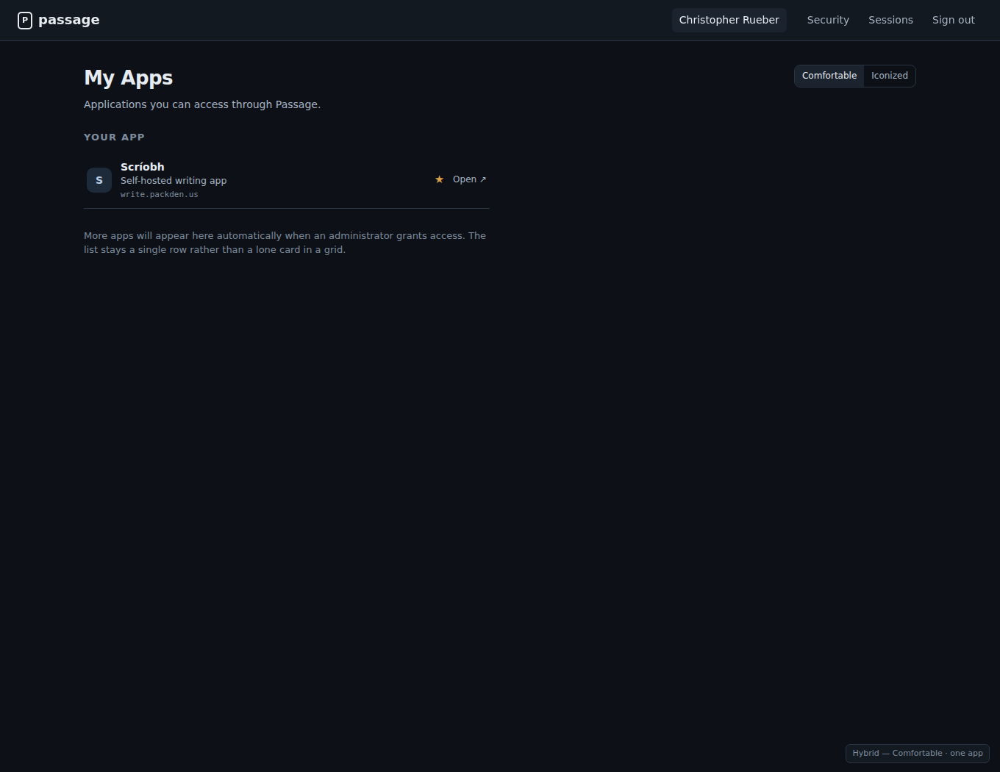

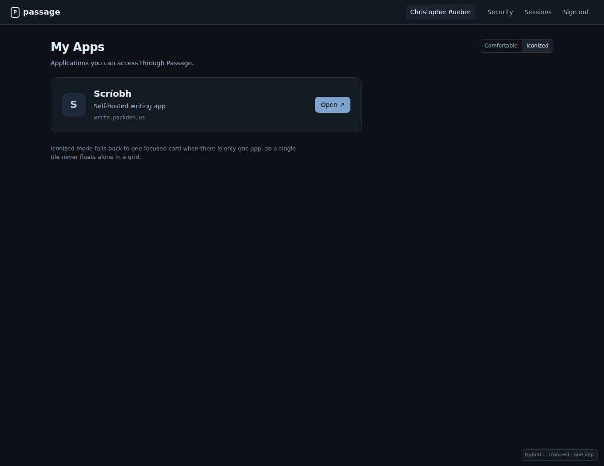

### Command launcher

`Ctrl K` (or `⌘ K` on macOS) opens a command-launcher modal over the page. There
is no permanent search field; the launcher is the only search UI, so the page
stays visually quiet.

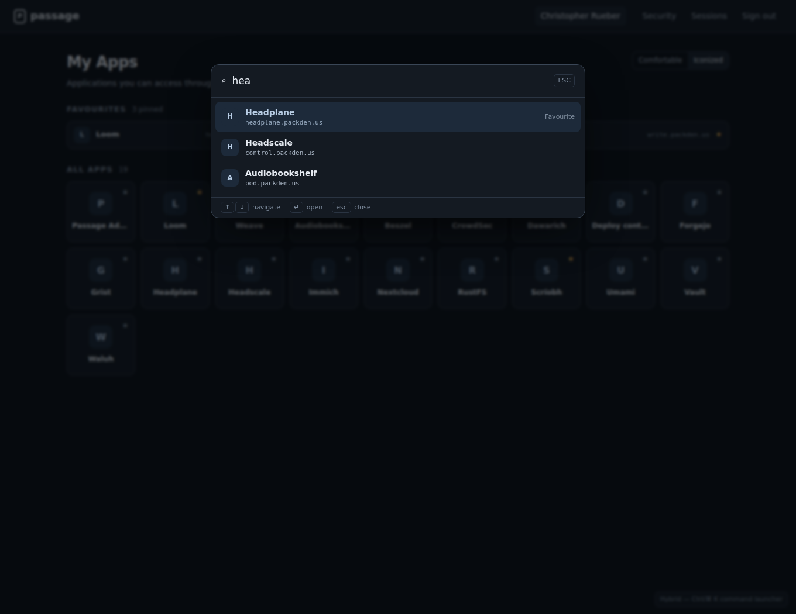

- Type-ahead matches name, slug and host (and possibly description); results
  update on every keystroke.
- Favourites sort first, then the rest; the first result is selected by default.
- `↑`/`↓` moves the selection, `Enter` opens, `Esc` closes.
- The dialog traps focus while open, restores focus to the page on close, and
  has an explicit empty-results state.
- Mobile has no keyboard chord, so a floating search button in the lower-right
  corner opens the same modal. The shortcut hint is shown only where it applies.

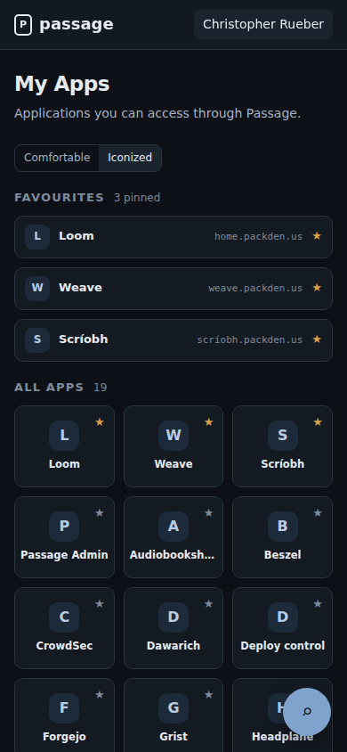

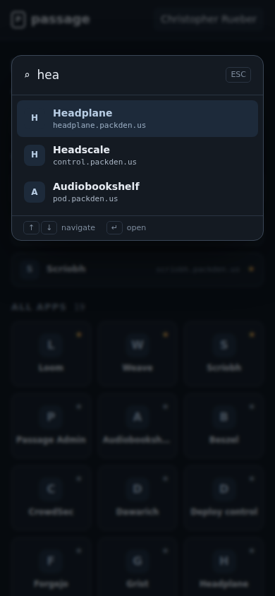

### What this resolves

- Hierarchy without losing the icon-led feel: the switch chooses between text
  scanning and icon scanning.
- Density: Comfortable rows and Iconized tiles both use substantially less
  vertical space than the current cards.
- Favouriting from the small layout: every tile carries a star control.
- Power-user speed: the command launcher is available from either mode.
- Single-app accounts: each mode has a deliberate state rather than a grid with
  one card.

### Resolved decisions

1. **Density stays per browser, with an account default as well.** The switch
   writes a browser preference (reusing the spirit of the current density
   preference; old `standard`/`condensed` values map to
   `comfortable`/`iconized`). Profile gains a **Default app view** setting stored
   on the account. Effective mode is: browser preference → account default →
   Comfortable. The account setting is the starting point on a new browser; it
   does not overwrite a choice already made on an existing one.
2. **No Recent section in the command launcher.** It lists favourites first,
   then all apps. No `last_opened_at` work is required for this redesign.
3. **Every tile shows its star at all times.** Outlined when not favourited,
   amber when it is; no hover-only affordance. The target is large enough for
   touch.
4. **Mobile search is a floating button in the lower-right corner**, not a
   field in the page head. It opens the same modal as the keyboard shortcut.

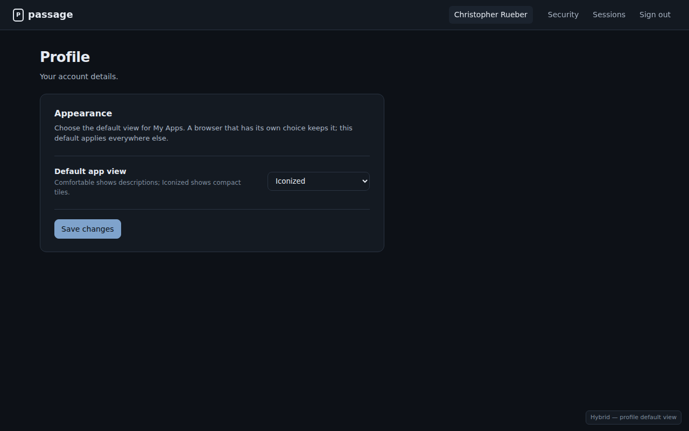

## Comparison

| | Grouped list | Launcher | Spotlight |
|---|---|---|---|
| Density with 19 apps | high | highest | highest |
| Hierarchy | strongest (groups) | strong (pinned shelf) | medium |
| Recognition | text + icon | icon + name | text |
| Single-app state | plain row + note | focused card | focused result |
| Mobile | easy (one column) | good (3–4 tiles/row) | good (stacked) |
| New data needed | none | none | recents need `last_opened_at` |
| Implementation effort | low/medium | low/medium | medium (search + keyboard) |

## Next steps for implementation

1. Replace the current card grid with the hybrid page: grouped Comfortable
   rows, Iconized shelf + tile grid, and the Comfortable/Iconized switch.
2. Keep the browser preference local (with a mapping from the old
   standard/condensed values) and add `users.app_view` for the account default,
   exposed on Profile. Use browser preference → account default → Comfortable.
3. Add the star button to every tile, reusing the existing
   `POST /apps/{id}/favorite` endpoint with an accessible label and optimistic
   state handling.
4. Build the command launcher as a single reusable dialog: type-ahead filter,
   keyboard navigation, focus trap, empty state, and the mobile floating
   button. No Recent section.
5. Add regression tests for many apps, one app, favourite toggling, the
   launcher’s filter/select/enter behaviour, and the precedence of browser vs
   account view mode.
